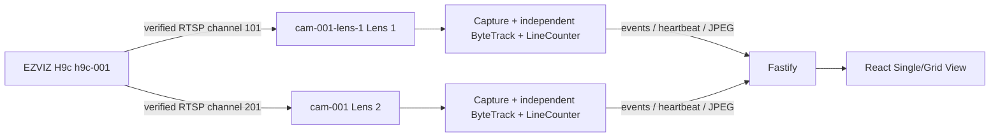

# Headless multi-camera runtime

The CV process is always headless. It never creates an OpenCV window; local display and dashboard streaming are separate concerns. `LIVE_PREVIEW_ENABLED` controls only annotated JPEG publication to Fastify.

## Physical and logical cameras

| Physical group | Logical camera | Stream status |
|---|---|---|
| `h9c-001` | `cam-001` / Lens 2 | Existing history preserved; channel `201` verified |
| `h9c-001` | `cam-001-lens-1` / Lens 1 | Channel `101` verified |

Both configured channel mappings were verified against real frames on 2026-11-06. If the camera firmware or channel configuration changes, revalidate the exact secret-bearing URLs before editing the mapping.

`config/cameras.yaml` contains IDs, labels, processing limits, and counting geometry. RTSP URLs remain in `.env`, referenced by `rtsp_url_env`. For migration, an enabled YAML camera whose ID equals legacy `CAMERA_ID` may use legacy `RTSP_URL` when its named URL variable is empty.

Each runtime owns its capture, Detector/ByteTrack state, session ID, line counter, heartbeat, metrics, and preview publisher. YOLO inference calls are serialized across cameras because concurrent access to Apple MPS and persistent Ultralytics tracker state is unsafe. Each logical camera has its own model/tracker instance; nano-model memory is traded for correct tracker isolation.

Wide and telephoto lenses may produce very different person box sizes. Optional per-camera `person_capture.min_confidence`, `min_width`, and `min_height` values adjust only best-frame candidate eligibility. They do not change line-crossing authority or vehicle counting. Both H9c lenses currently use a 960-pixel single-pass inference size and accept the same confidence floor as the realtime detector so smaller child/person boxes can enter the bounded candidate buffer; a confirmed line crossing remains mandatory before any capture is created.

Overlapping lens views can count the same real-world object twice. Counts are crossing events per logical camera, not unique identities. Cross-camera identity matching is intentionally out of scope.
