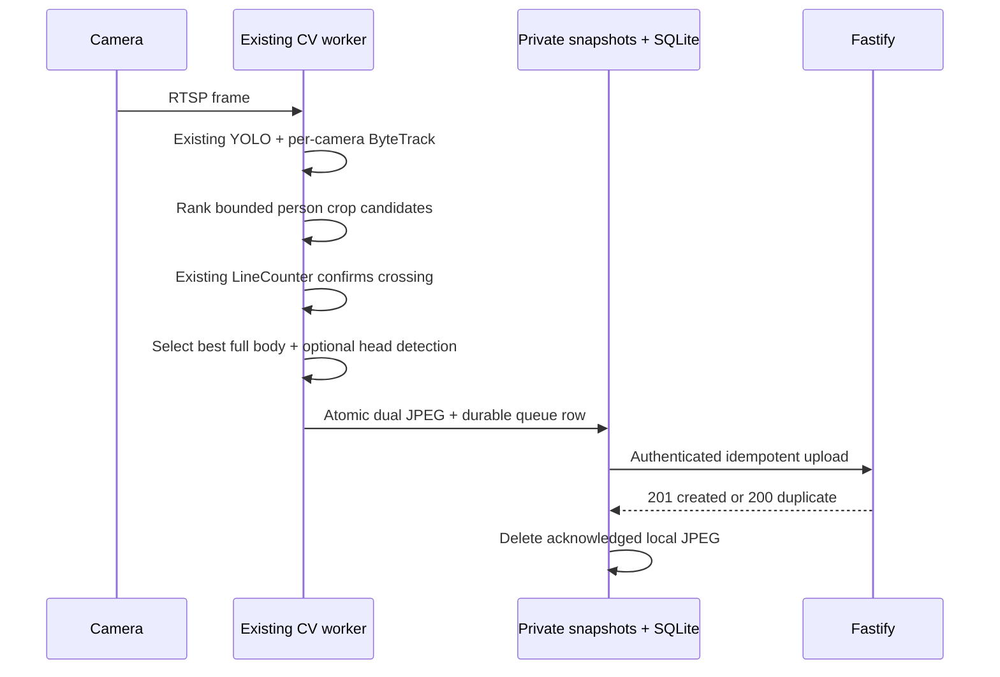

# Person capture pipeline

Every official line-crossing event receives a unique `crossingId`. That ID is the retry/idempotency key, together with the capture UUID and its `cameraId + tracking sessionId + trackId + lineId` context. Detection alone never creates a file, upload, record, or notification. The existing hysteresis-based `LineCounter` remains the only crossing authority and can re-arm after a stable side transition plus `COUNTING_REARM_SECONDS`. Therefore one crossing cannot jitter into duplicates, but the same active track may generate separate IN and OUT captures after genuine return crossings. The Phase 5 default `PERSON_CAPTURE_DIRECTION=both` finalizes both directions. A ByteTrack ID is not a permanent identity and is never compared across cameras, reconnects, or days. Quality ranking uses geometry and Laplacian sharpness; it performs no identity analysis.

Candidate buffers are bounded by `PERSON_CAPTURE_MAX_CANDIDATES` and `PERSON_CAPTURE_BUFFER_SECONDS`. Full-body crops reuse the existing YOLO person box. Optional head detection runs once on the chosen full-body crop after crossing, using only the explicitly configured `HEAD_DETECTION_MODEL_PATH`; it is not face recognition. See [head detector contract](head-detector.md).

The worker calls `POST /internal/cv/person-captures` with its Bearer service token. Both JPEGs share one capture UUID and are stored as `full-body.jpg` and optional `head.jpg`. Uploads run off the inference thread. HTTP 429, network failures, and 5xx responses retry; invalid 4xx responses remain invalid queue rows for diagnosis.
