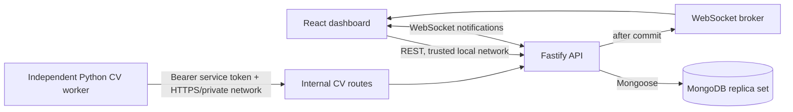
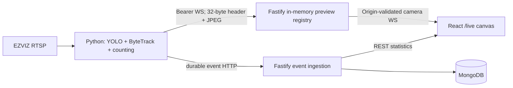

# Architecture

## System view

The dashboard renders real REST statistics and receives ephemeral annotated previews. The API owns validation, reporting boundaries, camera lifecycle, idempotent ingestion, persistence, and an in-process preview relay. The independent worker owns stream acquisition and computer vision.

Dual-lens devices use separate camera documents joined only by optional presentation metadata (`physicalCameraId`, `lensName`). Events, summaries, heartbeats, tracker sessions, and preview routing continue using logical `cameraId`; historical IDs are never renamed.

## Data flow

1. An administrator creates an active camera through the trusted-network REST API.
2. A future worker retrieves non-secret camera configuration using the service token.
3. The worker posts a line-crossing event with a globally unique `eventId`.
4. The API authenticates and validates it, confirms the camera is active, then starts a MongoDB transaction.
5. The transaction inserts the unique detection and increments its UTC hourly summary. Both commit or both roll back.
6. Only after commit, the API publishes detection and summary notifications. Dashboard queries are invalidated and REST remains the source of truth.

## Collections and indexes

- `cameras`: unique `cameraId`; timestamps; status, active state, and latest worker heartbeat metadata.
- `detection_events`: unique `eventId`; `{cameraId,timestamp}`, `{objectType,timestamp}`, and `{cameraId,objectType,direction,timestamp}` indexes.
- `counting_summaries`: unique `{cameraId,objectType,direction,periodType,periodStart}` plus a reporting index on period and camera.

Hourly buckets are stored in UTC. Reporting ranges are calculated in the selected IANA timezone (default `Asia/Jakarta`) and converted to UTC before querying, so a Jakarta day begins at 17:00 UTC on the preceding date.

## Transaction tradeoff

Transactional ingestion is the simplest reliable Phase 1 design: the unique event insert acts as the idempotency claim and summary increments share its commit. It requires a replica set or sharded MongoDB deployment and has more coordination cost than eventual aggregation. A later high-throughput design could store immutable events first and use a durable outbox/change stream plus reconciliation, but must preserve the same idempotency guarantee.

## WebSocket flow

The `/ws` connection remains the notification channel. The separate `/internal/cv/preview` endpoint authenticates one publisher per camera; `/ws/cameras/:cameraId/live` validates browser Origin and subscriber limits. Only the latest validated JPEG is retained in memory. Slow consumers drop frames and are eventually closed. This initial registry is process-local, so publisher and subscriber must use the same Fastify instance.

## Security boundaries

- The API binds to localhost by default and CORS/WebSocket origins use an explicit allowlist.
- Camera administration and detection history have no user login and therefore must remain on a trusted local network or behind a separately managed access layer.
- `/internal/cv/*` uses a dedicated Bearer token compared as fixed-length SHA-256 digests with constant-time comparison, route rate limits, and smaller body limits.
- Authorization headers and named secrets are redacted from logs. Responses never expose stack traces or MongoDB details.
- Production worker traffic must use HTTPS or a trusted encrypted private network. MongoDB is never exposed to the browser.
- A heartbeat proves recent worker communication. It does not independently prove that an RTSP stream is healthy; Phase 2 should report stream health separately.
