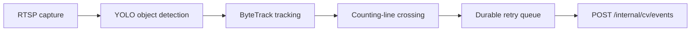

# Phase 2 CV integration

## Intended pipeline



Only classes `person` (`0`), `car` (`2`), and `motorcycle` (`3`) are allowed. A worker should emit an event once when a stable track crosses the configured line in a determined `in` or `out` direction. Frame-level detections and images must not be sent through this endpoint or WebSocket.

## Event contract and idempotency

The JSON contract contains `eventId`, `cameraId`, `sessionId`, non-negative integer `trackId`, object and event types, direction, optional confidence from 0 to 1, and an ISO 8601 UTC timestamp. Generate a deterministic globally unique `eventId`, for example from worker/session/camera/track/line/direction. Persist it in the worker retry queue; never generate a new ID for a retry.

Send `Authorization: Bearer <CV_SERVICE_TOKEN>` over HTTPS or a trusted encrypted private network. Treat `201` as newly committed and `200` with `duplicate:true` as successfully acknowledged. Retry network failures, `429`, and transient `5xx` with exponential backoff plus jitter. Do not retry permanent `400`, `401`, `404`, or inactive-camera `409` errors without correcting configuration. The API accepts events no more than five minutes in the future or 30 days old.

## Heartbeats and configuration

Post `/internal/cv/heartbeat` with `workerId`, `cameraId`, `online|offline`, and a UTC timestamp. The API derives effective offline state after `HEARTBEAT_TIMEOUT_SECONDS`; an online heartbeat proves worker connectivity only, not independent RTSP health. Phase 2 should distinguish capture/stream health in an explicit contract rather than overloading connectivity.

`GET /internal/cv/config` returns active camera IDs/names, enabled state, allowed classes, and a placeholder `countingLine`. It deliberately contains no RTSP URI or password. In Phase 2, store stream credentials in a secrets manager or worker-side encrypted configuration and return only a reference/lease to an authorized worker; never send them to the dashboard.

## Suggested future structure

```text
apps/cv/
├── pyproject.toml
├── src/cctv_cv/
│   ├── api_client.py
│   ├── capture.py
│   ├── detector.py
│   ├── tracker.py
│   ├── counting.py
│   ├── retry_queue.py
│   └── main.py
└── README.md
```

## Phase 2 checklist

- Select supported Python, OpenCV, YOLO, and ByteTrack versions for Apple Silicon and deployment targets.
- Define counting-line coordinates and versioned camera configuration.
- Implement secure RTSP credential retrieval without browser exposure.
- Add reconnecting capture and explicit stream-health reporting.
- Implement deterministic crossing semantics and durable event retry/idempotency.
- Add worker observability, bounded queues, backpressure, and graceful shutdown.
- Reconcile stored events against summaries operationally.
- Load-test ingestion and decide whether transactions remain sufficient or need an outbox/change-stream design.
