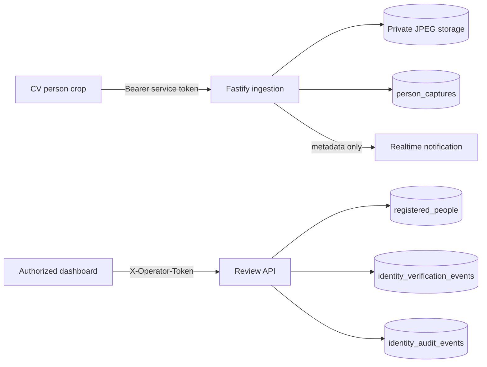

# Person labeling, verification, and privacy

## Operator boundary

`POST /internal/cv/person-captures` uses the existing CV Bearer token. `/api/person-captures*`, `/api/people*`, `/api/dataset*`, model registry routes, and identity overlays require `X-Operator-Token`. If `OPERATOR_TOKEN` is empty they fail closed with `503`. Private JPEGs are never mounted statically and use `Cache-Control: private, no-store`.

The general WebSocket broadcasts only capture ID, camera ID, timestamp, and review status. It never broadcasts images, names, addresses, credentials, or operator tokens. Deployments without user login must remain on a trusted local network or behind a trusted access gateway.

## Review workflow

Only persisted post-crossing captures emit metadata-only WebSocket notifications, and only operator-authenticated notification sockets receive them. Both genuine IN and OUT crossings become independent pending items. The labeling page shows full-body and optional head images and retains separate status and direction filters. Save buttons stay disabled with an animated spinner until persistence succeeds; failures retain form values.

Object annotation remains separate from resident labeling. Operators can add or correct normalized bounding boxes, return corrected annotations to draft, approve useful samples, or reject false/poor detections. Duplicate annotations are rejected and history is retained. Dataset exports contain object classes and capture provenance only—never resident identity fields.

The annotation tool provides a visual bounding-box editor. Select the full-body or head crop and an object class, then drag from one corner of the object to the opposite corner. The dashboard calculates normalized YOLO center X, center Y, width, and height automatically. A collapsed precision panel retains numeric editing for small corrections, and the full-image preset is useful only when the selected object genuinely fills the crop.

An operator may permanently delete a capture while it is `pending` or `dismissed`. The protected delete endpoint removes full-body/head files, the capture record, and any draft/rejected annotation data. It rejects captures that are reviewed, linked to a person, or referenced by an approved dataset annotation. A minimal `capture.deleted` audit event is retained without image or resident-profile content.

Clicking a capture card opens crop details, manual labeling, and detection dataset annotation in one protected modal. These tools no longer append below the capture grid.

After manual or credential verification, Fastify creates a short-lived association only if the exact camera/session/track is still present in protected preview metadata. The dashboard draws the verified name as an operator-side overlay. Names are never burned into relayed JPEGs and associations expire when the track/session disappears or the TTL elapses.

Registered profiles support resident, guest, staff, and other categories. Block and house number are optional and visible only through protected endpoints. Deactivation preserves historical references; anonymization clears identity details, credentials, and consent state while retaining referential metadata.

Registration is idempotent for the normalized combination of full name, category, block, and house number. Case and repeated surrounding/internal whitespace do not create a second profile, and a unique database key prevents concurrent duplicate submissions. Notes and consent are not identity-matching inputs. This registration key is private API metadata and is never exported to the YOLO dataset; detection training continues to use only object classes and bounding boxes.

## Optional credentials

The protected API can generate a random high-entropy, one-time credential at `POST /api/people/:personId/credentials`, shown once and bounded by `CREDENTIAL_TTL_SECONDS`. `POST /api/person-captures/:captureId/verify-credential` links a new crossing only after a valid credential. MongoDB stores only its HMAC verifier using `CREDENTIAL_PEPPER`; used, expired, or revoked credentials fail closed, and verification is rate limited and audited.

## Retention and responsibilities

Pending and reviewed image retention are controlled separately. Cleanup removes private JPEGs and records `imageDeletedAt`; minimal metadata remains for audit/reference. These defaults are operational settings, not legal advice. A residential deployment is responsible for lawful basis, notice/signage, consent handling where applicable, access requests, secure operator-token distribution, and an appropriate retention policy.

Known limitations: no biometric matching, no automatic resident recognition, no cross-camera identity, and no claim that a detected person is an intruder. A manual label may be wrong and must be treated as an operator assertion.
