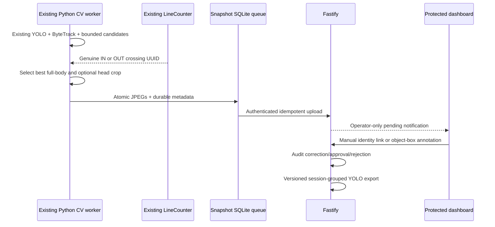

# Phase 5 directional person capture and detector curation

Inference and preview remain continuous before and after crossing. `PERSON_CAPTURE_DIRECTION=both` permits one capture for each genuine directional crossing. The existing signed-distance hysteresis band and `COUNTING_REARM_SECONDS` suppress jitter; every accepted transition receives a different `crossingId`, so a later return by the same session/track remains valid.

The Person Labeling page preserves its layout and adds independent status and direction filters. IN and OUT cards use the same protected full-body/head retrieval and manual registered-person workflow. Object annotation is separate from resident identity: corrections return to draft, identical boxes are rejected, and create/update/approve/reject history is retained.

Dataset export contains only detection classes, boxes, capture provenance summaries, and version metadata. It groups train/validation by camera plus tracking session when multiple sessions are available. Training is administrator initiated; evaluation records overall and per-class metrics. Candidate rejection, approval, activation, and rollback are registry operations only and never overwrite the running model.

`GET /api/person-captures/quality-metrics` reports observable crossing-to-capture and crop outcomes per camera/direction. Missed detections and false negatives still require a separately annotated evaluation video; the API does not fabricate ground truth from absent events.
